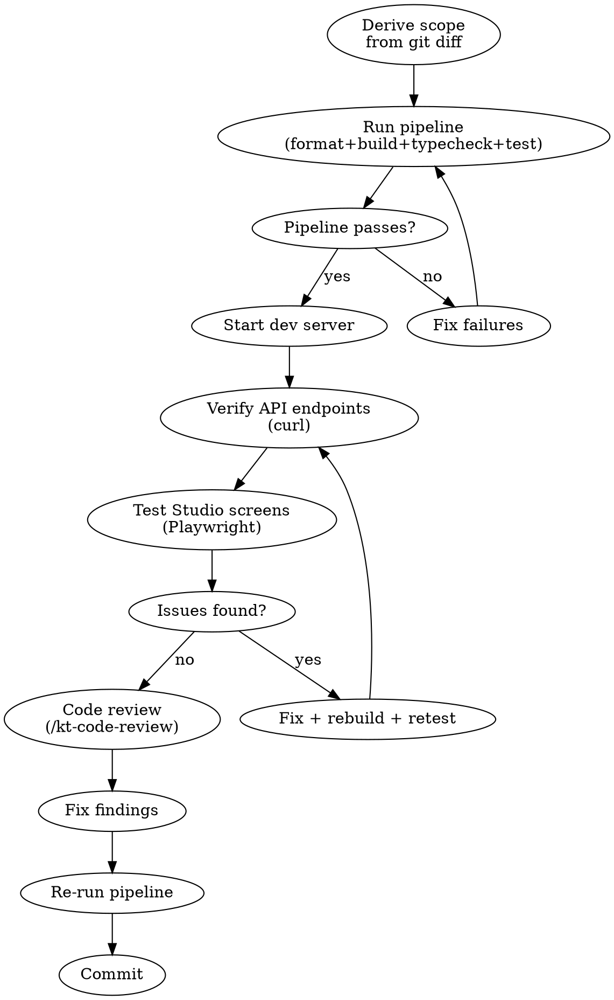

# Freestyle QA

## Contents

- Core Flow
- Phase 1: Derive and Present Test Scope
- Phase 2: Pipeline
- Phase 3: Dev Server
- Phase 4: API Verification
- Phase 5: Playwright Testing
- Phase 6: Fix + Code Review
- Phase 7: Report
- Phase 8: Commit
- Project-Specific
- Related Skills
- Known Gotchas
- Rules

**When this skill is invoked, execute it immediately. Do not ask for confirmation. Start at Phase 1.**

Diff-driven full-stack QA. Test scope is derived from what changed on the branch — never hardcoded.

Skip this skill when only docs changed (no runtime to test).

## Core Flow



## Phase 1: Derive and Present Test Scope

```bash
git diff --name-only master...HEAD | grep -E '\.tsx?$' | grep -v test/
```

Map changed files to test targets using `scope-map.md`. Then **present the test plan before executing**:

```markdown
### Test Plan (derived from diff)

**Changed files**: N source files

**API endpoints to test**:
- `GET /api/capabilities` (new — capabilities.ts)
- `POST /api/content/:c/:s/lock` (new — content-lock.ts)
- `PUT /api/content/:c/:s` (modified — update-content.ts, concurrency added)
- ...

**Studio screens to test**:
- Pulse `/studio` (shell/destinations.ts changed — capability-aware navigation)
- Editor `/studio/site/pages/home` (editor/use-editor-actions.ts changed — lock + concurrency + version)
- Checkpoints `/studio/setup/checkpoints` (Checkpoints.tsx — verify loads)
- ...

**Interactions to verify**:
- Editor: save → version bumps from v1 to v2
- Editor: lock indicator shows on open
- Checkpoints: create checkpoint works
- ...
```

Present this plan, then execute it step by step.

## Phase 2: Pipeline

```bash
pnpm run format
pnpm run build
pnpm run typecheck
pnpm run test:run
pnpm --filter @krantho/studio run build
```

Stop on failure. Fix before continuing.

## Phase 3: Dev Server

```bash
lsof -ti:4002 | xargs kill -9 2>/dev/null
rm -f examples/nextjs-shadcn/krantho.db
rm -rf examples/nextjs-shadcn/.krantho examples/nextjs-shadcn/.next
mkdir -p examples/nextjs-shadcn/.krantho
cd examples/nextjs-shadcn && pnpm run dev --port 4002 &
```

Poll until ready:
```bash
curl -s http://localhost:4002/api/collections | grep '"collections"'
```

Check server logs for: content imported, no errors, correct schema version.

## Phase 4: API Verification

Curl each affected endpoint. Verify:
- Response shape matches types (e.g., `meta.version` exists)
- Success path returns expected status
- Error paths return correct codes (400, 404, 409)

## Phase 5: Playwright Testing

For each affected Studio screen:
1. `browser_navigate` → take screenshot
2. Verify content loaded (check snapshot for headings, data)
3. If change involves interaction — perform it (edit, save, create)
4. Screenshot after interaction — verify success/error
5. Check `browser_console_messages` for JS errors

Ask user to join for: file uploads, visual layout review, multi-tab flows.

## Phase 6: Fix + Code Review

Fix all issues found. Then:
```
/kt-code-review on current branch only and fix all findings
```

Re-run pipeline after fixes.

## Phase 7: Report

After all phases complete, present a structured QA report. This is the deliverable — the user acts on this.

```markdown
## QA Report: [branch name]

**Scope**: N changed source files → N API endpoints tested, N Studio screens tested
**Pipeline**: format ✓ | build ✓ | typecheck ✓ | tests N/N ✓

### API Verification

| Endpoint | Method | Status | Issue |
|----------|--------|--------|-------|
| /api/capabilities | GET | ✓ 200 | — |
| /api/content/pages | GET | ✓ 200 | — |
| /api/content/pages/home/lock | POST | ✗ 404 | Route not registered |

### Playwright Screens

| Screen | URL | Status | Issue |
|--------|-----|--------|-------|
| Pulse | /studio | ✓ | — |
| Editor | /studio/site/pages/home | ✓ | — |
| Checkpoints | /studio/setup/checkpoints | ✗ | entityTypes crash |

### Console Errors
- None (or list each error with screen where it occurred)

### Bugs Found

| # | Severity | Description | File | Fixed? |
|---|----------|-------------|------|--------|
| 1 | Blocker | Capabilities returns 404 | create-api-handlers.ts | ✓ |
| 2 | Minor | Status defaults to draft on save | editor/use-editor-actions.ts | Deferred |

### Fixes Applied
- `file.ts:line` — what was changed and why

### Remaining Issues
- Items not fixed in this run (with reason: deferred, needs discussion, etc.)
```

Every field in the report must be filled. Empty sections get "None" not omitted.

## Phase 8: Commit

Stage specific files. Conventional commit. Final pipeline run. Leave the dev server running; the developer tests alongside.

## Project-Specific

- **Dev server**: `examples/nextjs-shadcn` on port 4002
- **DB files to clean**: `krantho.db` (server root) + `.krantho/` (media)
- **Studio SPA**: must `pnpm --filter @krantho/studio run build` before testing
- **API shape**: All content endpoints return `ContentDocument` (`{ meta, fields, body, html, sections }`)
- **Versioning**: Every save creates a new version. Verify `meta.version` increments.
- **Quality pipeline**: `pnpm run format:check && pnpm run build && pnpm run typecheck && pnpm run test:run`

## Related Skills

- **`/kt-code-review`** — invoked in Phase 6 for code quality analysis on the branch
- **`/freestyle`** — the development skill this QA skill complements; freestyle builds, kt-qa verifies
- **`/kt-start`** — issue-driven workflow; use kt-qa after implementation, before PR

## Known Gotchas

| Issue | Cause | Prevention |
|-------|-------|------------|
| API returns HTML not JSON | Stale `.next` cache | Always `rm -rf .next` before restart |
| `no such column` errors | Stale DB from before migration | Delete both `krantho.db` and `.krantho/` |
| Console crash on missing field | API response shape changed but Studio types not updated | Verify response shape with curl before Playwright |
| Tests expect old migration count | New migration added | Update migration-runner test counts |
| Server adapter tests send old field names | Missed during rename sweep | Grep all test files after renames |
| `Cannot open database because the directory does not exist` | `.krantho/` dir deleted | `mkdir -p .krantho` before server start |

## Rules

- Test scope is ALWAYS from the diff — never hardcoded
- Every changed API handler gets a curl test
- Every changed Studio screen gets a Playwright test
- Console errors are bugs — fix them
- Server startup errors are blockers
- Fix immediately, don't batch
- Re-run full pipeline after every fix
- **NEVER close a PR** — not without explicit user consent. Creating a new PR does not mean closing the old one. Leave existing PRs as they are. The user manages PR lifecycle.
